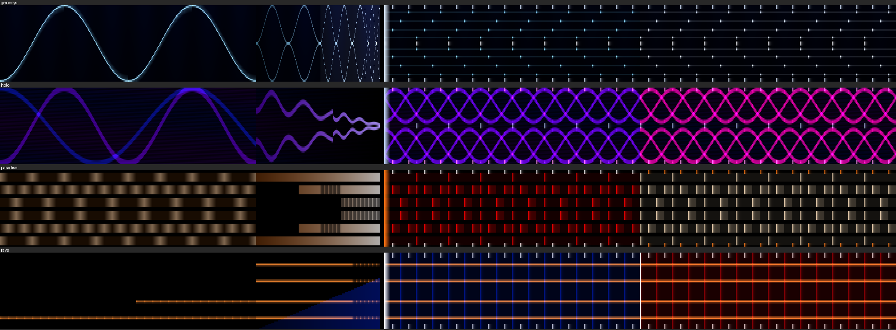

# Stage looks: what makes famous electronic shows work, on 60 pixels

The stage looks in `arcade/stage/` take their style from four of the most talked-about
live productions in electronic music. Each look runs as a live sound-reactive pattern,
as a generated song-show look ("Add a song"), and the calmer two also run in the
idle rotation.

## Research

**Anyma ("Genesys", "The End of Genesys" at the Las Vegas Sphere).** The visuals were
built in Unreal Engine 5. Video, lighting and sound were locked together by timecode
(Disguise), and the show was told in four acts. Reviews describe sharp, precise laser
beams that move with each drop and transition, cold chrome-and-blue imagery on a black
void, and a recurring "spine" motif. Anyma has said he cares a great deal about the
exact quality of the light.

**Eric Prydz (EPIC, HOLO, Holosphere).** Holographic layers on two screens, one in
front of the performer and one behind, give a parallax depth that a flat screen
cannot. EPIC 6.0 used more than 540 fixtures around an 8 m sphere. Critics call the
result cinematic: deep blues and violets, slow sweeping beams and long emotional
builds that open into a white blinder.

**Swedish House Mafia (Paradise Again).** The tour had a circular rig and deliberately
no video, so the lights carried every moment. Strobes and blinders (GLP JDC1s on the
comeback shows) and ER Productions lasers worked in mostly monochrome, one color per
song: red, or warm white. Big moments hit the whole ring at once.

**Fred again.. (the Ed Warren-lit raves, including the MSG show with Skrillex and
Four Tet).** "Minimal" and "sparse" were the brief. Club shows started with desk lamps
and grew as the night went on. The palette was limited to blue, red, green and white,
and strobes gave both the flashes and the color washes.

## Conclusion: why these shows work

1. **Darkness is the canvas.** Most of the time most of the rig is off. A hit only
   looks big next to darkness, so the floor stays low and the peaks stay rare.
2. **A tiny palette per moment.** One or two hues plus white, held for a whole phrase.
   Color changes are events, not decoration.
3. **White is saved for the peak.** The brightest, whitest light (blinders, strobes,
   reveals) appears when a drop lands or a phrase opens, and almost nowhere else.
4. **Phrasing over beats.** Looks change on 8- and 16-bar phrase boundaries. The
   kick drives *intensity*; *movement* runs on bar-length cycles (two to sixteen
   bars), so the eye is never yanked back and forth on every beat.
5. **Tension and release.** Breakdowns are dark and slow, builds narrow and speed up,
   then comes a breath of darkness and one huge reveal as the drop lands.
6. **Symmetry and fixed geometry.** A spine, a ring or a mirrored laser fan: the
   audience learns the structure, and the music lights parts of it.
7. **Tight timing.** Hits land in the same frame as the beat and decay fast (a sharp
   attack and an exponential release of about 60-150 ms), which reads as punch instead
   of mush.

## How each look applies it

| Look | Palette | Geometry and motion | Breakdown, build, drop |
| --- | --- | --- | --- |
| `genesys` (Anyma) | black, deep-blue haze, ice cyan and chrome lines; every 4th phrase crimson | A thin spine scans up over 2 bars and back over 2; a fixed, mirrored four-rung laser fan | A slow scan over the haze; mirrored scans double their speed twice; one rung flares per beat and the core ignites on beat 1 |
| `holo` (Eric Prydz) | ultramarine-to-violet depth, violet/magenta beams, cool white | A back gradient drifts over 16 bars under interlace lines; beams glide on 2-6 bar cycles (parallax) | Two beams cross slowly; the beams close on the centre and narrow; a fan of three mirrored beam pairs; the kick lifts the beams only slightly |
| `paradise` (Swedish House Mafia) | red phrase, then warm-white phrase; an amber blinder | Six truss blocks, lit in mirrored pairs (the ring seen edge-on) | An amber ring with one pair circling per bar; the ring fills from the outside in; the kick steps a pair and beat 1 fires the whole ring |
| `rave` (Fred again..) | warm lamps; blue, red, then green washes; white strobe | Four lamps at uneven positions; a full-strip wash; almost no motion | Starts with one lamp and adds one every 4 bars; the wash creeps up from the floor; the wash breathes on beats 1 and 3, with one white strobe per 8-bar phrase |

All looks share the project's rhythm language: the snare flashes both ends of the
strip. They stay within 3 large-area flashes per second without help from
`engine.FlashGuard` (checked in `tests/test_stage_looks.py`).

The existing beat patterns (Center glow, Mirrored blocks, Comet tail, Inward
diamonds) follow rules 1 and 4: they rest darker between hits and swap primary and
accent colors only at 8-bar phrase starts.

Each look over 8 bars of breakdown, 4 bars of build and 16 bars of drop at 128 BPM
(time runs left to right, the strip runs bottom to top):

## Sections in live mode

A song show names its section in each cue. Live input has no cue sheet, so
`arcade/stage/cues.py` (`Arrangement`) infers the section:

- **Breakdown:** no kick for about 2.5 beats.
- **Build:** a breakdown that swells louder than its 10-second average (risers),
  held for at least a second.
- **Drop:** the kick returns. If it was gone for 4 s or more, the drop opens with the
  look's reveal flash.

## Sources

- [The making of Anyma's "The End of Genesys" (YMCinema)](https://ymcinema.com/2025/01/30/the-making-of-anymas-the-end-of-genesys-at-the-las-vegas-sphere-a-groundbreaking-fusion-of-music-and-technology/)
- [Anyma: The End of Genesys stage production (Digital Music News)](https://www.digitalmusicnews.com/2025/03/19/anyma-the-end-of-genesys-stage-production-sphere-las-vegas/)
- [Alexander Wessely on designing The End of Genesys (Flaunt)](https://flaunt.com/post/alexander-wessely-designing-the-end-of-genesys-at-the-sphere-las-vegas)
- [Eric Prydz HOLO debut (EDMTunes)](https://www.edmtunes.com/2018/06/eric-prydz-holo-debut/)
- [EPIC 6.0 Holosphere (TPI via Issuu)](https://issuu.com/mondiale/docs/tpiaug19_digitallr/s/131283)
- [Eric Prydz HOLO, powered by Avolites (LSi)](https://lsionline.com/news/eric-prydz-holo-show-powered-by-avolites)
- [Swedish House Mafia's live show has no front row (Sixtysix)](https://sixtysixmag.com/swedish-house-mafia/)
- [GLP solution for the Swedish House Mafia reunion (LSi)](https://www.lsionline.com/glp-solution-for-swedish-house-mafia-reunion)
- [Swedish House Mafia lasers (ER Productions)](https://www.er-productions.com/swedish-house-mafia)
- [How Ed Warren designed the Skrillex / Fred again.. / Four Tet MSG rave (EDM.com)](https://edm.com/interviews/skrillex-fred-again-four-tet-msg-rave-how-ed-warren-designed-lighting-lasers/)
- [Ed Warren: Spontaneous Light (Chauvet Professional)](https://chauvetprofessional.com/news/ed-warren-spontaneous-light/)
